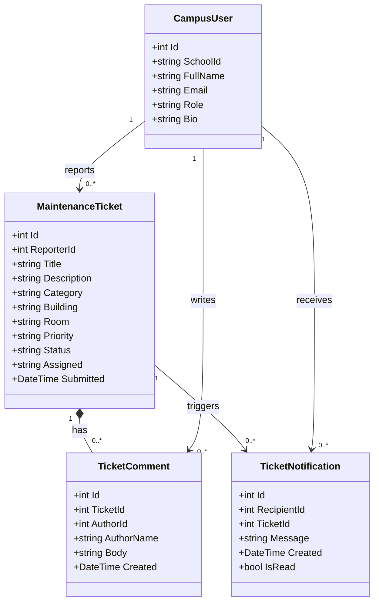

# CampusFix class diagram

This diagram models the first database entities for the CampusFix maintenance
request portal. Help Center FAQ entries remain static demo content and are not
included as database entities.

`ReporterId`, `TicketId`, `AuthorId`, and `RecipientId` are the foreign-key
fields shown by the associations. Passwords are deliberately excluded from
this initial profile model; authentication should be handled by a secure
identity provider rather than stored as plain text.
